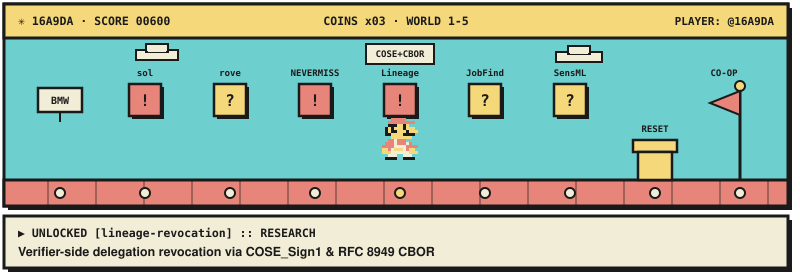

 

<a href="https://github.com/16A9DA/16A9DA/issues/new?title=mario:left&body=Click+%27Create%27+to+move+Mario+left!"><kbd>&nbsp;◀ LEFT&nbsp;</kbd></a>
&nbsp;
<a href="https://github.com/16A9DA/16A9DA/issues/new?title=mario:jump&body=Click+%27Create%27+to+jump+%26+hit+this+block!"><kbd>&nbsp;▲ JUMP / HIT ?&nbsp;</kbd></a>
&nbsp;
<a href="https://github.com/16A9DA/16A9DA/issues/new?title=mario:right&body=Click+%27Create%27+to+move+Mario+right!"><kbd>&nbsp;▶ RIGHT&nbsp;</kbd></a>
&nbsp;
<a href="https://github.com/16A9DA/16A9DA/issues/new?title=mario:reset&body=Click+%27Create%27+to+reset+World+1-1!"><kbd>&nbsp;↻ RESET&nbsp;</kbd></a>

---

**Rayyan Ahmed** · Agentic AI Intern @ **BMW** · CS @ University of Debrecen · *Always learning*

| Stage | World | Game Point / Repo |
| :---: | :--- | :--- |
| **0** | **Start** | **BMW** *(Agentic AI Intern)* · `System Design` · `LangChain` |
| **1–3** | **Agentic AI** | [`sol`](https://github.com/16A9DA/sol) *(local multi-model coding agent)* · [`rove`](https://github.com/16A9DA/rove) *(macOS computer-use agent)* · [`NEVERMISSAI`](https://github.com/16A9DA/NEVERMISSAI) *(🥇 Kanz AI Gold voice agent)* |
| **4** | **Research** | [`lineage-revocation`](https://github.com/16A9DA/lineage-revocation) *(COSE_Sign1 + RFC 8949 deterministic CBOR delegation verifier)* |
| **5–6** | **Model Training** | [`Job-Finder`](https://github.com/16A9DA/Job-Finder) *(OCR + Llama 3 + 90% MLP)* · [`predictive-maintenance`](https://github.com/16A9DA/predictive-maintenance-failure-detection) *(10k sensor GBDT, 0.68 minority F1)* |
| **7** | **Mobile AI** | [`RESET`](https://github.com/16A9DA/RESET) *(SwiftUI + SwiftData local-first AI health app)* |
| **8** | **Flagpole (Co-op)** | [LinkedIn](https://linkedin.com/in/16a9da) · [Email](mailto:rayyan.tanweer@gmail.com) · [Discord](https://discordapp.com/users/584487184141254731) |

`Python` · `PyTorch` · `LangChain` · `FastAPI` · `Ollama` · `RAG` · `Docker` · `Swift` · `System Design`

