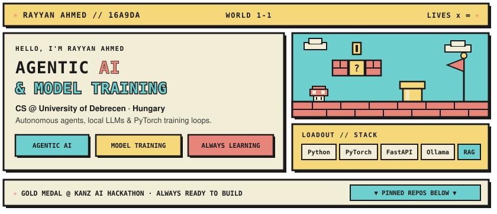

  

<a href="https://linkedin.com/in/16a9da"><kbd>&nbsp;LINKEDIN&nbsp;</kbd></a>
&nbsp;
<a href="mailto:rayyan.tanweer@gmail.com"><kbd>&nbsp;EMAIL&nbsp;</kbd></a>
&nbsp;
<a href="https://discordapp.com/users/584487184141254731"><kbd>&nbsp;DISCORD&nbsp;</kbd></a>

